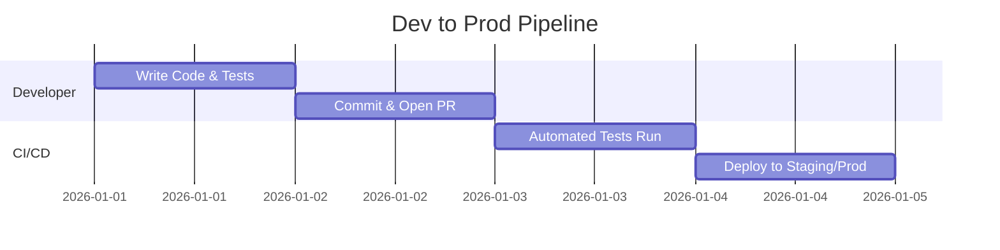

# Anki Playground

[](LICENSE)
[](#)
[](#)

This repository contains the source code for **Anki Playground**, a gamified learning suite and desktop add-on for Anki.

---

## What Is This Project?

Anki Playground is a **Python & Flutter Web-based Anki Add-on** that serves as an interactive, gamified study suite. It is designed to give Anki desktop users a quick and reliable way to study flashcards through engaging mini-games, customizable learning activities, and native scheduler synchronizations.

---

## Architecture

The diagram below shows how the different parts of this project connect — from the underlying data to the end-user experience.

```mermaid
mindmap
  root(([Anki Playground]))
    Build / CI
      package.sh
      Zip Bundler (.ankiaddon)
    Components
      Flutter Web UI
      Qt AnkiWebView Bridge
      Python Native Host
    Tech Stack
      Python 3
      Flutter / Dart / CanvasKit
      PyQt / Qt WebEngine
    Data
      Anki Collection (mw.col)
      Media Files & Sounds
      config.json
```

---

## Why Does It Exist?

As someone building in **EdTech and Developer Tools**, I noticed that traditional flashcard review workflows can feel monotonous during long study sessions. This project acts as a bridge between Anki's battle-tested spaced repetition scheduler and modern, delightful mini-game interfaces. Building this also provided hands-on experience with:

* Real-time bi-directional IPC bridges between Python (Qt) and Flutter Web
* Native Anki database (`mw.col`) queries and FSRS/V3 scheduler integration
* Packaging and automated deployment workflows for desktop software add-ons

---

## How It Works

The project operates by embedding a high-performance Flutter Web application inside Anki's native `AnkiWebView` modal dialog. When triggered, the Python host extracts deck metadata, card queues, images, and audio directly from the user's local Anki collection and sends them to Flutter via `pycmd` bridge channels. Review actions, card ratings, flags, and states are instantly synchronized back into Anki's native database.

| Technology | Purpose |
| --- | --- |
| **Python 3** | Core host add-on logic, database queries, and Anki hooks |
| **Flutter / Dart** | Cross-platform frontend application and interactive game engine |
| **PyQt6 / AnkiWebView** | Native modal container, web view hosting, and IPC communication bridge |
| **CanvasKit / WebAssembly** | High-performance graphics rendering for Flutter Web in the WebView |

---

## Repository Structure

<details>
<summary><strong>Click to expand the full project structure</strong></summary>

```text
anki-playground/
├── __init__.py                 # Add-on entry point, IPC bridge dispatch, Anki hooks
├── manifest.json               # Anki add-on manifest (package: anki_playground)
├── config.json                 # Add-on user preferences & query defaults
├── package.sh                  # Packaging & automated Anki add-on sync script
├── anki_playground.ankiaddon   # Packaged distribution archive for Anki
├── anki_playground_web/        # Flutter Web build artifacts & CanvasKit runtime
│   ├── index.html              # Web entry point
│   ├── flutter.js              # Flutter engine loader
│   ├── flutter_bootstrap.js    # Web initialization script
│   ├── main.dart.js            # Compiled application bundle
│   ├── canvaskit/              # WebAssembly graphics engine
│   └── assets/                 # Icons, fonts, and assets
├── LICENSE                     # GNU General Public License v3.0
└── README.md                   # Project documentation
```

</details>

---

## Development Workflow

This Gantt chart illustrates the typical workflow from writing code to pushing it live:



---

## How to Run Locally

<details>
<summary><strong>Click to expand setup instructions</strong></summary>

1. Make sure you have **Anki (23.10+ recommended)** and **Bash** installed on your machine.
2. Clone the repository:
```bash
git clone https://github.com/AIJosue/anki-playground.git
```

3. Choose a development setup method:

### Option A: Live Symlink (Recommended)
Symlink the repository directly to your Anki add-on folder so changes reflect on reload:

**Linux (Native):**
```bash
mkdir -p ~/.local/share/Anki2/addons21
ln -s "$(pwd)" ~/.local/share/Anki2/addons21/anki_playground
```

**Linux (Flatpak):**
```bash
mkdir -p ~/.var/app/net.ankiweb.Anki/data/Anki2/addons21
ln -s "$(pwd)" ~/.var/app/net.ankiweb.Anki/data/Anki2/addons21/anki_playground
```

**macOS:**
```bash
mkdir -p "$HOME/Library/Application Support/Anki2/addons21"
ln -s "$(pwd)" "$HOME/Library/Application Support/Anki2/addons21/anki_playground"
```

**Windows (PowerShell):**
```powershell
New-Item -ItemType SymbolicLink -Path "$env:APPDATA\Anki2\addons21\anki_playground" -Target (Get-Location)
```

### Option B: Build & Auto-Sync
Package the `.ankiaddon` file and synchronize directly into Anki's add-on directory:
```bash
chmod +x package.sh
./package.sh
```

4. Launch Anki and access Anki Playground via:
* `Tools` → `Anki Playground` (`Ctrl+Shift+S`)
* Deck options gear menu → `🎮 Play in Anki Playground`
* Reviewer bottom toolbar → `🎮 Anki Playground`

</details>
